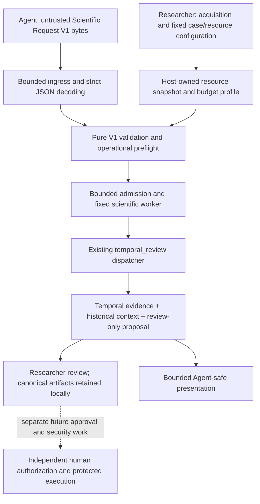

# Day 5 / Checkpoint 5A — Controlled host architecture review

Date: 2026-11-03 (Asia/Taipei). Status: **Scientific & Security Architecture
Review; implementation awaits researcher approval.** This document proposes
interfaces and acceptance criteria; none of the proposed host functionality
exists as a result of this checkpoint.

```text
Windows Local Isolation: NOT VERIFIED
Trusted Human Authorization: NOT VERIFIED
Execution Eligibility: FALSE
```

## 1. Repository preparation and Day 4 baseline

[PR #4](https://github.com/wen237/ionospheric-tec-anomaly-framework/pull/4)
was inspected through the connected GitHub tool: `state=closed`, `merged=true`,
merge commit `6911ec959428ac7bab033943ba900cc73b746bf8`. After fetching `origin`,
local `main` and `origin/main` both resolve to that commit; their left/right
commit counts are `0 / 0`. The strict dispatcher is present in `origin/main`.
No fast-forward was necessary. New local branch `agent/day5-controlled-host`
was created from that updated `main`, at the same commit.

Before switching, there were no tracked changes and four untracked backups:
`agent_day1_5_final_review.patch`, `agent_day1_5_review.patch`,
`agent_day3_checkpoint3_review.patch`, and `agent_day3_final_review.patch`.
Their SHA-256 values were recorded for the final preservation check. No stash,
cleanup, reset, or backup rewrite was used. The existing Day 4 remote reference
`origin/agent/day4-scientific-planning` points to
`3aea2a837081da8872e6f157e90ba33e3381ef65`; no local Day 4 branch existed in
the initial branch listing. Neither the Day 4 branch nor its remote was modified.
No commit, push, or new PR is part of this checkpoint.

The older [agent handoff](agent_handoff.md) remains useful for scientific
invariants and original-data provenance; its unfinished-integration descriptions
predate the inspected Day 4 implementation. The following baseline comes from
current source and tests, rather than treating the older status as current.

| Existing contract/module | Observed behavior and boundary |
| --- | --- |
| [`scientific_request.py`](../src/workflow/scientific_request.py) | `dispatch_scientific_request(request: dict, *, time_series_id, time_series, historical_summary_id, historical_summary_path)` accepts only V1 `temporal_review` and explicit `retrospective` mode. It rejects missing/unknown fields, unsupported types and operations, path-like resource IDs, duplicate selections, invalid UTC bounds and invalid detector/provenance metadata. The host supplies one `TECTimeSeries` and one absolute `Path`, separately from request data. It returns the existing three dictionaries. |
| [`temporal_workflow.py`](../src/workflow/temporal_workflow.py) | `run_temporal_review` copies and validates the full series, fingerprints all supplied rows and metadata, loads/validates/hashes the summary, runs A once on the full series, clips detector results, constructs temporal evidence, then invokes the planner. It does not plot or write artifacts. |
| [`planning_evidence.py`](../src/workflow/planning_evidence.py) | Temporal Evidence V1 distinguishes positive, negative, valid normal, unclassifiable and absent timestamps. Requested-hour evidence includes absent hours. Historical Context Evidence V1 validates the reproduction summary and preserves it; loading context does not recompute B/C. The loader rejects duplicate JSON keys and nonstandard constants, but reads the entire file with `Path.read_bytes()`. |
| [`window_planning.py`](../src/workflow/window_planning.py) | The unchanged daily policy requires at least one target-polarity anomaly and no opposite-polarity anomaly, plus the separate requirement of 24 present/classifiable hours. Explicitly selected anchors expand bidirectionally until a nonqualifying day. Ties/quality failures abstain. Anchor UTC hour does not define intraday boundaries. Membership validation occurs here, after A. Every anchor remains in the report, including unselected context. |
| [`planning_approval.py`](../src/workflow/planning_approval.py) | Immutable intent/decision contracts and pure consistency/lineage validation exist. An `approved` declaration still denies execution and does not authenticate a human. Production review/dispatch creates neither contract. |
| [`signed_authorization_v1.md`](signed_authorization_v1.md), [`authorization_store_v1.md`](authorization_store_v1.md), [`local_authorization.md`](local_authorization.md) | Signed statements, complete-history Store validation and a locally configured verifier are groundwork. Their bounded codecs and content pins do not establish trusted bootstrap, source custody, human presence or protected execution. They are outside the review host's call graph. |
| [`windows_deployment_preparation.md`](windows_deployment_preparation.md), [`c2_lock_acceptance.md`](c2_lock_acceptance.md), [`c2_e1_deployment_readiness.md`](c2_e1_deployment_readiness.md) | Preparation and C2/E1 plans remain non-executing. Native acceptance and independent VM management are unconfirmed; deployment remains NO_GO. These do not provide resource containment for a scientific worker. |

Input provenance and event source references are inert declarations. The computed
full-series digest and summary-byte hash identify supplied content; they do not
authenticate original observations or researcher identity. Summary evidence also
contains its bound absolute path and preserves upstream input paths. That matters
for any future Agent-visible response.

Scientific preservation: historical 1999–2021 B+C context remains distinct from
the 2022 event series. Original saved historical TEC and the verified catalog
remain the reproduction sources; no download or reconstruction is required here.
No algorithms, reference values, polarity, grids, UTC conventions or detector
parameters are changed. Modern and Legacy Stage 2 remain separate existing
pathways. The validated D reference remains 120 hours, 71 × 73 grids, positive
maximum 10% at (-22.5,-155) and (-22.5,-150), and negative maximum 85% at (30,70).
It was not executed or revalidated at this checkpoint.

## 2. Proposed host architecture and trust boundaries

Recommend a small fixed-purpose host around the existing dispatcher, initially
as a local researcher-invoked adapter with synthetic tests. Do not expose an
untrusted service until its finite budget profile and resource custody are
accepted. A Python object boundary is useful for validation, but cannot isolate
malicious code running under the same identity or in the same interpreter.



The dashed relationship is a future architectural dependency, not an enabled
endpoint. This host has no authorization, signing, Store, D or Stage 2 route.
Existing Stage 2 entry points are not globally intercepted by the Day 4 code;
future OS deployment must prevent their invocation through other capabilities.

Roles and data flow:

1. **Researcher-controlled acquisition:** select the case, trusted resource IDs,
   complete in-memory series and summary file outside the Agent request. Record
   acquisition provenance, expected content identities, UTC convention and a
   reviewed detector configuration. Preselect a single resource pair at startup;
   do not add an Agent-driven registry, discovery or acquisition API. Any future
   additional cases need separately provisioned, case-scoped bindings.
2. **Agent proposal:** submit only the existing V1 scientific request. Resource
   IDs select no filesystem objects; they must match the already-bound pair.
   Metadata source references never trigger downloads or file reads. A familiar
   ID is neither a credential nor evidence that a resource is authentic.
3. **Ingress:** acquire a bounded byte frame, strictly decode it and apply
   structural/token budgets before scientific work. No Python dict/object,
   pickle, callable, loader, module name, command, URL-fetch or path interface is
   exposed to the Agent. Transport identity/admission control is separate from
   scientific authorization; no network transport is selected here.
4. **Preflight:** use the same V1 validation semantics as dispatch, verify the
   fixed case/resource binding, then apply host budgets to the complete series,
   validated summary, analysis and selections before A. Bind case/event metadata
   and detector tuple to the researcher-reviewed configuration; a requested
   change is rejected for review, never silently overwritten. This host policy
   does not narrow the underlying scientific library's supported experiments.
5. **Scientific review:** make one call to the existing dispatcher with the
   owned snapshot and fixed summary path. Revalidate at dispatch. Never retry
   with relaxed detector parameters, remove missing hours, shorten data, choose
   fewer anchors or truncate a candidate window to satisfy a budget.
6. **Results:** retain the unchanged evidence/context/proposal for the researcher.
   Report operational rejection separately from scientific abstention. No result,
   including a candidate or a structurally valid request, grants execution.

Use the existing review evidence fingerprints. A separate host receipt may bind
the raw request hash, budget-profile identity, resource snapshot hashes, code
version and canonical result hashes. It is diagnostic content integrity, not a
DecisionRecord, approval token or authenticated audit log. Do not add receipt
fields to V1 evidence/proposal or change their digest algorithms.

For Agent presentation, return a bounded derivative containing review status,
candidate explanations and opaque artifact references, with researcher-approved
fields only. Full canonical artifacts remain researcher-local because they can
expose absolute paths, upstream metadata and detailed TEC. Never redact an
existing artifact in place or describe a redacted projection as its original
hashed evidence. Artifact IDs must not become arbitrary file-read endpoints.
The presentation/export allowlist is a prerequisite for an external Agent API.

## 3. Strict transport decoding

Scientific Request V1 currently accepts a dictionary: duplicate-key evidence is
already lost if ordinary JSON decoding happens upstream. The proposed host must
own the raw-byte boundary and reject before calling the dispatcher:

- Oversized frames: read at most `max_request_bytes + 1` while enforcing the cap;
  reject overflow before assembling an unbounded buffer. A declared content
  length is insufficient. Disable compressed input initially, or separately
  bound decompressed bytes. Apply deadlines to incomplete frames as well.
- Invalid UTF-8, a BOM, invalid Unicode scalar strings such as lone surrogates,
  malformed JSON, trailing non-whitespace/concatenated documents, and a root
  other than an exact JSON object. Do not normalize, repair, or coerce content.
- Duplicate keys at **every** object level, including keys equivalent after
  JSON escape decoding, such as `operation` and `oper\u0061tion`.
- Nonstandard `NaN`/`Infinity` constants and numeric overflow such as `1e999`.
  Preserve native integer/finite-float distinctions; V1 still excludes booleans
  as scientific numbers. Limit numeric token length before conversion.
- Depth, total node/member count, strings and collection widths exceeding the
  profile. A bounded lexical framing pass must understand quoted strings and
  escapes before counting containers; naive brace counting is insufficient.
  The standard decoder remains authoritative for JSON syntax. Its duplicate-key
  hook and rejecting constant/numeric hooks are required as well.

A post-decode depth check alone does not protect the decoder from deep input.
A byte cap alone does not impose per-string, collection or compute limits.
Handle expected decoding/depth errors as bounded input failures without echoing
the payload; keep unexpected implementation failures visible to local diagnostics.
Do not import the authorization codec merely to obtain its limits: its numeric
profile, schema purpose and protected-module dependencies differ.

## 4. Resource budgets and ownership

Budget values are operational acceptance limits, not scientific significance
thresholds. They belong to a versioned, researcher-controlled host profile; the
Agent cannot supply, increase or disable them. A concrete profile must be finite
and benchmarked before exposure. Missing or invalid limits prevent startup.
This review intentionally approves no numeric defaults without workload and
machine measurements. In particular, neither the 2022 120-hour D reference nor
the historical 23-year coverage should be repurposed as a universal host limit.

| Budget | Owner / point of enforcement | Measurement and failure behavior |
| --- | --- | --- |
| `max_request_bytes`, frame deadline | Ingress owner, before decoding | Actual UTF-8 transport bytes; bounded incremental read, reject overflow/timeout. Upstream buffering must also be bounded. |
| `max_json_depth`, `max_json_nodes`, `max_number_token_chars` | Host decoder | Enforce depth/token limits before expensive conversion; bound decoded nodes, keys and collection widths. |
| `max_string_utf8_bytes`, `max_total_string_utf8_bytes`, `max_provenance_sources` | Host decoder/preflight | Bound decoded keys/strings, case/event/source text and processing history, plus aggregate metadata. Resource IDs retain the existing 64-character grammar. |
| `max_series_samples`, `max_series_array_bytes`, `max_series_metadata_bytes` | Acquisition owner, before allocation/copy and again at binding | Entire bound series, including reference and unused rows; dimensionality/dtypes must satisfy existing contracts. Account separately for object timestamps and owned copies: NumPy `nbytes` does not count referenced Python objects. Do not accept custom object arrays or deserialized Python values from the Agent. |
| `max_summary_bytes`, summary JSON structure/collection limits | Acquisition owner, before full read/parse | Bounded read of the selected regular file, not just `stat().st_size`. Bound actual arrays/events/cells/anchors and any declared dimensions used by validators before they allocate derived structures. Never open paths mentioned inside the summary. |
| `max_analysis_hours` | Preflight, before A/evidence | Compute `(end_utc - start_utc) // one_hour + 1` using validated bounds without constructing an hourly list. Includes absent requested hours, even for a sparse or short series. |
| `max_selected_cluster_ids`, `max_summary_anchors`, `max_planning_work_units` | Preflight, before A | Bound selection length early, then membership in the validated summary. Bound all context anchors too; reports retain unselected anchors. Conservatively budget anchors × analysis days for expansion/report work. Preserve empty-selection abstention. |
| `max_reference_days`, `max_detector_work_units` | Preflight, before A | Bound the declared reference-day loop and conservatively `full_series_samples × reference_days`. Small analysis bounds do not reduce A's full-series workload. Reject excessive work without changing the requested detector tuple. |
| `max_response_bytes`, retained-artifact/log quotas | Host result owner | Bound serialization, IPC and presentation output. Estimate before dispatch where possible; enforce a bounded sink afterward. Oversize output is an operational failure, never silently truncated scientific evidence. Bound retention and error text too. |
| Concurrent jobs, queue length, request rate, total service allowance | Host supervisor/admission owner | Start with one admitted job at a time and a bounded or zero queue; reject excess admission. Repeated individually valid requests still consume resources. No automatic retry storm. |
| Worker wall time, CPU time, memory, native threads, child processes | Deployment/supervisor owner | Requires independently enforced process/OS controls and acceptance evidence. Cancel/discard incomplete results on breach; never return partial evidence as a successful review. |

The summary preflight needs protection before recursive copying and before
schema routines construct expected arrays from declared sizes. A small byte file
can still declare huge dimensions. Existing contract validation remains the
scientific authority; operational checks only reject oversized work.

CPU exposure includes A's timestamp dictionary, per-row reference lookup and
percentiles. Memory includes the input snapshot, datetime objects, canonical
fingerprint header/TEC bytes, detector arrays, requested-hour dictionaries,
historical copies and planner reconstruction/serialization. No constant-factor
RAM guarantee follows from sample counts or the work-unit estimate. Measurements
must include worst-case accepted metadata, missing coverage and response size.

**Validation versus containment:** byte/count/work limits reject known oversized
inputs; they cannot terminate a native call, cap a process's committed memory or
stop hostile same-process code. Python timers, profiling hooks, `frozen=True`,
private attributes and a subprocess alone do not establish OS isolation. A later
worker design should use a fixed executable/import path, sanitized startup,
bounded data-only IPC, no Agent-selected arguments/environment/modules, and
independently enforced lifetime, memory, CPU and descendant restrictions.
The exact Windows mechanism and effective limits require separate deployment
review and native acceptance. No such mechanism is configured or claimed here.

## 5. Trusted binding and file custody

The host bootstrap must be controlled independently of Agent input: code and
dependencies, policy values, case/event identity, resource IDs and expected
content pins all belong to that side. A request containing a digest and the file
it hashes does not supply an independent trust anchor. If the Agent can edit the
host's code, configuration, ancestor directories or startup environment, it can
bypass Python validation. The development checkout is not an established
protected deployment.

At acquisition, use existing adapters and original researcher-provided inputs.
Publish only a pre-extracted `TECTimeSeries` and validated historical-summary
snapshot to review. Make owned arrays and avoid shared caller-writable memory;
read-only array flags are accidental-mutation protection, not a security boundary.
Do not crop the full series to make it fit: its fingerprint and potentially
reference behavior would change. A different snapshot requires a new explicit
researcher acquisition decision and fresh evidence.

The current dispatcher requires a path and the current workflow reopens it.
Checking size/hash before dispatch, resolving a path, or checking it after
dispatch does not close concurrent replacement or read-growth races. Early
cluster preflight also cannot rely on a summary different from the one A/planning
will consume. Two future integration options require explicit review:

1. Preserve V1 unchanged and operate only against a host-owned immutable snapshot
   whose file and ancestors remain inaccessible to Agent/concurrent writers for
   the entire bounded read, preflight and dispatch. The fixed snapshot path is
   the loader's artifact identity; retain original source identity separately
   and do not claim the snapshot path is the original source.
2. Separately design a bounded, single-read summary-byte/evidence input seam so
   preflight and review consume the identical captured content. Keep the legacy
   path interface compatible and preserve existing hash/provenance meaning.

Recommend option 1 for the smallest adapter **only when custody is demonstrated**;
otherwise keep it synthetic/local and block untrusted exposure. Option 2 is a
possible later contract change, not implicitly approved implementation here.
Neither option authenticates the upstream historical sources by itself.

Future custody review must address reparse points, symlink/hard-link aliases,
ancestor replacement, file identity, access rights, sharing modes, writable
handles and resource updates. Portable `resolve()`/`is_file()` checks are not
proof of effective Windows restrictions. Failed custody or changed bindings
invalidate the review job; do not fall back to another file or stale result.

## 6. Proposed module interfaces (design only)

Keep the scientific implementation and V1 schemas intact. Prefer three small
modules over a general tool framework; all names below are proposals:

| Proposed interface | Responsibility and restrictions |
| --- | --- |
| `scientific_request_codec.decode_request(raw: bytes, *, limits: DecodeLimits) -> dict` | Pure bounded decoding of one native JSON request. No I/O, resource lookup, authorization imports or callbacks. Ingress must already have bounded acquisition of `raw`. |
| `scientific_host_policy.preflight_request(request, *, resource_facts: BoundResourceFacts, policy: HostBudgetProfile) -> PreflightReport` | Pure operational budgets, fixed-case constraints and validated-summary membership. Returns cost measurements or typed rejection; cannot acquire resources or mutate scientific parameters. Facts must come from the trusted binding, never from request claims. |
| `controlled_scientific_host.ControlledReviewHost(resources: BoundReviewResources, *, policy: HostBudgetProfile)` | Trusted-side construction with one owned series and one fixed summary snapshot/path plus case metadata. No Agent-facing constructor/configuration endpoint. Resource facts include actual sizes, validated anchors, UTC convention and content identities. |
| `ControlledReviewHost.review(raw_request: bytes) -> HostReviewResult` | The sole proposed Agent-facing operation. Decode, validate, preflight, admit, then call the fixed dispatcher once. Return bounded review presentation; retain the original evidence tuple for researcher review. No per-call resource/policy overrides, output path, executor, `trust` or `execute` option. |

There is currently no reusable public pure request validator. To avoid a second
schema implementation, a later checkpoint should narrowly extract
`validate_scientific_request(request) -> ValidatedScientificRequest` from
`scientific_request.py`, have the existing dispatcher reuse it, and preserve
all current acceptance/rejection and keyword-binding behavior. It must not load
files or run A. Review that refactor separately before depending on it for early
preflight. The internal validated value is detached data, not an authorization
capability, executable closure or new Agent schema. Retain dispatch revalidation.

`HostReviewResult` should distinguish `request_rejected`, `budget_rejected`,
`resource_unavailable`, `review_completed`, and `worker_failed`; the existing
proposal retains its own candidate/abstention status. All host results carry
`review_only=true`, `execution_eligible=false`, and unverified isolation/human
authorization status in a separate envelope. Success does not mean approval.
Errors expose bounded codes to the Agent; filesystem details and tracebacks stay
in quota-controlled local diagnostics. The host never constructs an execution
intent, decision record, attestation or Store entry.

## 7. Synthetic testing strategy

Future tests use tiny in-memory series and hand-authored summary fixtures, never
downloaded or synthesized substitutes for missing research observations.

1. **Codec boundaries:** exact byte cap and cap+1, multi-byte UTF-8, BOM/invalid
   encoding, nested and escaped duplicate keys, scalar roots, trailing JSON,
   constants/float overflow, large numeric tokens, strings/width/nodes/depth at
   and over each limit. Confirm rejection before dispatch or filesystem access.
2. **Budgets:** independently vary complete-series size, unused/reference rows,
   reference days, inclusive analysis hours including absent hours, summary
   bytes, declared dimensions, all/selected anchors, provenance and output size.
   Use tiny injected limits so rejection tests never allocate huge arrays or run
   deliberately exhausting calculations. Check empty selection still abstains.
3. **Binding:** wrong IDs/case/event/convention/detector tuple fail before A;
   path-like metadata remains inert. Only the fixed summary is read. Changed
   summary/series invalidates the binding. Simulate replacement/growth and
   writable-memory aliases with synthetic resources. Such simulations verify
   application behavior, not native file custody.
4. **Parity:** for accepted requests compare the unchanged three artifacts with
   direct Day 4 dispatch, including digests, full-input fingerprint, UTC behavior,
   mixed/tied polarity, missing coverage and abstention. Assert no input mutation
   and exactly one detector/dispatcher call, with no relaxed-parameter retries.
5. **Forbidden paths:** retain the inspected protected-call sentinel and use
   harmless namespace-labelled canaries. Block imports/calls into D, Stage 2,
   signing, Store and authorization verifier; assert production review creates
   no intent/decision declarations. Do not call real protected implementations
   to test the guard. Headless fresh-process tests must remain plotting-free.
6. **Presentation/admission:** oversized output and queue/rate exhaustion fail
   without partial success; canonical artifacts remain unchanged; Agent-visible
   output/errors disclose no paths or hidden raw input. Exercise bounded IPC
   framing/cancellation with harmless synthetic workers if separately approved.
7. **Separate native acceptance:** actual CPU/memory/time enforcement, descendant
   termination, effective file custody, identity/startup and IPC restrictions
   need a researcher-approved disposable environment and independent observer.
   Python unit tests cannot establish those properties. No native deployment
   or authorization experiment is authorized by this review.

## 8. Risks, prerequisites and recommended checkpoints

Untrusted exposure remains blocked by unselected finite budget values and
benchmarks, unverified resource custody and bootstrap, undecided transport and
presentation/export policy, and absent independently enforced worker limits.
Repeated requests, output growth and log retention need aggregate admission
controls even when individual requests fit. Parser/NumPy/dependency failures
remain possible within accepted bounds. No source-content hash authenticates a
researcher's identity or the custody of its own expected pin.

Scientific limitations remain explicit: loading historical context is not a new
B/C reproduction; historical anchors are retrospective evidence rather than
complete UTC windows, predictions or causal findings. Review-only acceptance
cannot establish observation quality, interpolation history or a seismic
precursor. A later host needs fresh real-data composition review as a separate
task; this checkpoint does not require access to original local datasets.

Recommended sequence, each subject to researcher review:

| Checkpoint | Proposed scope / acceptance gate |
| --- | --- |
| **5A — this document** | Approve or revise trust boundaries, validator seam, custody option, budget ownership and export policy. No functionality implemented. |
| **5B — codec and pure preflight** | Select a finite operational profile; narrowly extract reusable V1 validation, add bounded decoder and policy checks with synthetic tests. Dispatcher parity must hold; no scientific algorithms or authorization modules change. |
| **5C — local fixed-resource adapter** | Integrate one preselected pair with owned snapshots, early summary/selection budgets and one dispatcher call. Retain canonical results and test safe presentation. Synthetic/local review only; no claim of secure service or OS custody. |
| **5D — resource measurements and containment design** | Benchmark accepted workloads; revise explicit operational limits; specify fixed worker startup, IPC and native CPU/memory/lifetime/custody acceptance. Designing containment does not deploy it. |
| **Separate deployment/security gate** | Researcher selects and independently controls a suitable environment and approves exact native work. Only later evidence can support isolation claims. Existing Windows/C2 prerequisites and authorization custody/history questions remain separate. |
| **Separate scientific integration review** | Review real-data composition and candidate derivation with the researcher. Any future protected execution requires its own trusted authorization and execution design; the review host stays review-only. |

## 9. Executed checks and checkpoint handoff

Changed path: **only this document**. No source, test, dependency, research data,
Legacy output or scientific reference was edited. No real-data execution was
needed; no unresolved Legacy numerical difference was investigated or claimed.

Git commands used the per-command option
`-c safe.directory=C:/Users/Wen/Documents/GitHub/ionospheric-tec-anomaly-framework`.
The initial plain Git read failed its ownership check; no global Git setting was
changed. Sandbox attempts to fetch/create the branch could not write
`.git/FETCH_HEAD` / `.git/index.lock`; those exact operations succeeded after
explicit escalation. This grants repository-operation access, not scientific
or human authorization.

Executed repository checks (with that Git option):

```text
git status --short --branch
git branch -v
git remote -v
git fetch origin
git log -3 --oneline origin/main
git branch -a -v
git rev-list --left-right --count main...origin/main
git show origin/main:src/workflow/scientific_request.py
git switch -c agent/day5-controlled-host main
```

Read-only GitHub check: `github.fetch_pr` for repository
`wen237/ionospheric-tec-anomaly-framework`, PR `4`; merged status and SHA recorded
above. Relevant modules, contract documents, request tests and their imported
fixtures/guards were inspected before selecting the test command.

Executed focused validation:

```powershell
.\.venv\Scripts\python.exe --version
.\.venv\Scripts\python.exe -B -m pytest tests/workflow/test_scientific_request.py -q -p no:cacheprovider
```

Observed: Python **3.10.6**; **144 passed in 7.84s**, no failures. These existing
synthetic tests exercise Day 4 dispatch and a test-only protected-call guard;
they do not test the proposed host or prove OS isolation. They include pure
non-authorizing review declarations, but no signing/key, Store or authorization
verifier operations. Temporary synthetic test files are pytest-managed; no
research output artifact was produced.

`python -m pytest tests -q` was **not run**: the full suite contains actual D,
Stage 2, ephemeral key/signing, Store and authorization operations prohibited by
this checkpoint. The specific user restriction takes precedence over the general
repository full-suite instruction. No full-suite pass or fresh protected-runtime
validation is claimed.

Final repository checks (with the same per-command Git safe-directory option):

```text
git status --short --branch
git rev-parse HEAD main origin/main origin/agent/day4-scientific-planning
git diff --name-only
git diff --check
git diff --no-index --check -- /dev/null docs/day5_checkpoint5a_controlled_host_review.md
```

Observed: current branch is `agent/day5-controlled-host`; HEAD/main/origin/main
remain at the merge SHA above, and the Day 4 reference is unchanged. Tracked
diff is empty. The only new file is this document, alongside the four existing
untracked backups. The tracked whitespace check passed; the new-file no-index
check reported no whitespace errors (exit 1 for the file difference, with Git's
LF-to-CRLF conversion notice). Nothing was staged.
A separate read-only Python document check passed: all 13 Markdown link targets
were accounted for (local targets exist; the PR link was inspected separately),
the document ends with a newline, and no line has trailing whitespace.

Backup verification command:

```powershell
Get-FileHash -Algorithm SHA256 -LiteralPath agent_day1_5_final_review.patch,agent_day1_5_review.patch,agent_day3_checkpoint3_review.patch,agent_day3_final_review.patch | ForEach-Object { '{0} {1}' -f (Split-Path -Leaf $_.Path), $_.Hash }
```

All four hashes matched the pre-switch readings:

```text
agent_day1_5_final_review.patch       1A42F3A075B68D7EE898DACAF9699DB6CE67801B29FD92CDC263EC1DA043A2FD
agent_day1_5_review.patch             40932142536B97E2FA75F862CACED0417F66F1A7ED2D5FE55BBC4C4B3B3E7143
agent_day3_checkpoint3_review.patch   F29558CB8503AF9092C853CE10243392B1DD54ADBEF90C2E28593E0DFA3F8E72
agent_day3_final_review.patch         2F8C080362ECB8B7E35920FE36149DEFB0D425BFAA054A7DE79586FA3C354383
```

Stop at Scientific & Security Architecture Review. Researcher approval of the
design is pending; no implementation, commit, push, PR or deployment follows
automatically from these findings.
