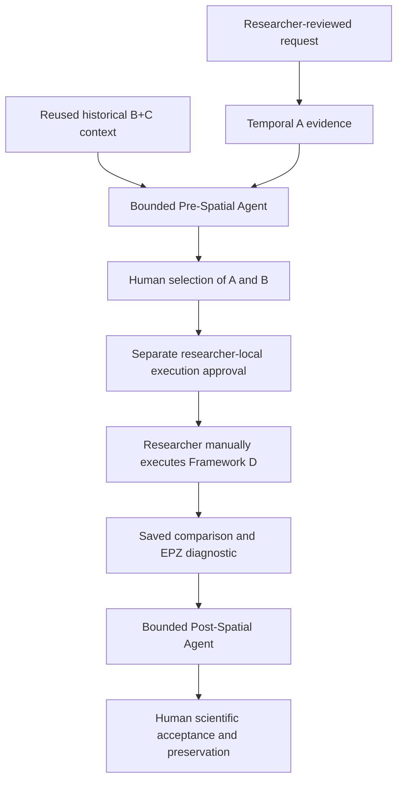

# Human-in-the-Loop Scientific AI Agent MVP

E2E-03 is a completed, researcher-accepted Afghanistan research MVP with
documented limitations. Reusable code supports scientific evidence preparation,
saved-snapshot validation and bounded Agent interpretation. Acceptance does not
establish earthquake causality, validated precursor identification, predictive
performance, complete physical attribution or full published-framework equivalence.

This public guide describes the software and reproduction boundaries. Original
scientific inputs, accepted local Handoffs, live API traces, private audit records
and generated experiment artifacts are not distributed here.

The opt-in [Scientific Reasoning Enhancement](scientific_reasoning_enhancement.md)
extends this workflow with hourly window contribution diagnostics, saved
space-weather evidence and bounded follow-up proposals. It preserves the accepted
assessment schema when disabled and grants no scientific execution authority.

## Architecture and human decisions



This is a sequence of separately reviewed stages, not an autonomous executor.
The researcher selects inputs and windows, approves applicable local execution
conditions, personally executes Framework D, reviews diagnostic pins, approves
any model/cost/evidence-sharing scope and makes the final scientific decision.
An Agent recommendation, successful process or valid assessment grants no
execution authority. A failed evaluation is preserved for review; restarting it
requires a separate decision.

The researcher-personal manual profile is distinct from future Agent-controlled
protected execution. It does not require implementing a multi-user identity or
controlled-runner platform. It does require explicit scoped approval, validated
inputs/runtime, a fresh output destination and reproducible records. Researcher
declarations remain self-attestation.

```text
Windows Local Isolation: NOT VERIFIED
Trusted Human Authorization: NOT VERIFIED
Protected Execution Eligibility: FALSE
Agent-controlled Framework D: PROHIBITED
```

These states describe protected-execution readiness, not a denial of the
separately approved personal manual profile. The tool interface is not verified
OS isolation. Neither this guide nor acceptance of an earlier run authorizes
additional scientific or model execution.

## Reusable entry points

Run Python modules from the repository root in the reviewed environment.
Scientific entry points require separately approved original inputs and scope;
the table is not a script to execute all stages.

| Stage | Entry point | Boundary |
| --- | --- | --- |
| Request and temporal review | [examples.review_afghanistan_mvp](../examples/review_afghanistan_mvp.py) | Prepares A evidence and review-only daily-window proposals; reuses saved B+C context. |
| Inspect/select windows | [examples.select_afghanistan_mvp_window](../examples/select_afghanistan_mvp_window.py) | Validates the parent bundle; explicit candidate or independent UTC selection. A temporal anchor alone is not a complete window. |
| Plan and compare A/B | [examples.compare_afghanistan_mvp_spatial](../examples/compare_afghanistan_mvp_spatial.py) | `plan` checks bindings without D computation; `run` is researcher-manual scientific execution after separate approval. |
| Diagnostic | [examples.diagnose_afghanistan_epicentral_zone](../examples/diagnose_afghanistan_epicentral_zone.py) | Separately reviewed offline diagnostic over saved spatial results; no D rerun. |
| Agent CLI | [examples.run_afghanistan_mvp_agent](../examples/run_afghanistan_mvp_agent.py) | Explicit `pre_spatial` or `post_spatial`; `--fake-script` is an offline test double, while `--live` requires separate API approval and an explicit model. |
| Evidence and assessment checks | [scientific_evidence_tools.py](../src/agent/scientific_evidence_tools.py), [epz_evidence.py](../src/agent/epz_evidence.py), [scientific_review_agent.py](../src/agent/scientific_review_agent.py) | Bounded saved-evidence views, independent EPZ host pins, strict citations and assessment validation; no scientific execution tool. |
| Human handoff contract | [blank template](day5_e2e_hitl_handoff_template.json) | Human-maintained preparation template, not an authenticated approval or standalone JSON Schema. Completed records stay local. |

These wrappers are case-specific. Reuse their validation mechanisms without
claiming that editing metadata alone generalizes the Afghanistan workflow.

The [dated preparation runbook](day5_e2e_hitl_execution_runbook.md) records the
manual profile and proposed stage interfaces. Its preparation STOP statements
and original 4,096-token/32 KiB envelope settings describe historical preparation,
not a new approval or current implementation limits. Preserve historical records;
use the current limits below when reviewing a new evaluation's scope.

## Inputs and local placeholders

Use researcher-provided locations rather than machine-specific defaults:

| Placeholder | Required content |
| --- | --- |
| `<MODERN_NPZ_DIR>` | Original existing 2022 Modern daily NPZ inputs; no substitute data. |
| `<ORIGINAL_HISTORICAL_BC_SUMMARY>` | Saved summary derived from the original 1999-2021 historical TEC and verified catalog pathway, with recorded provenance. |
| `<EVIDENCE_ROOT>` | Local bound parent directory retaining the required bundle layout and source identities. |
| `<NEW_OUTPUT_DIR>` | Fresh destination outside accepted evidence/input directories; preserve partial failures. |
| `<APPROVED_MODEL>` | Explicit researcher-approved model for any separately authorized live evaluation. |
| `<EPZ_IDENTITY>`, `<EPZ_SHA256>`, `<EPZ_BYTES>` | Independently reviewed diagnostic identity relative to the evidence root and exact host pin. |

A fresh full Afghanistan temporal review needs the existing daily inputs from
May 7 through June 21, 2022: the May 22 analysis start plus its 15 reference days.
The fixed D comparison uses the May 13-June 1/2 subsets. The original saved
historical TEC and catalog are required for a separately approved historical
B+C reproduction; replaying saved evidence does not reopen or recompute them.
A new 23-year GIM download or historical reconstruction is not a prerequisite.

Preserve the fixed child layout for the temporal review bundle, A/B selections
and comparison. Supply the Post-Spatial diagnostic through its host binding,
not through a model-supplied path. Do not move bound files or replace originals
to satisfy an integrity check.

Offline tests use synthetic fixtures and need no scientific input download.
Project dependencies are listed in [requirements.txt](../requirements.txt).
[requirements-agent.txt](../requirements-agent.txt) is the optional live SDK
dependency; injected offline clients do not need live transport or credentials.
Record actual interpreter/dependency versions for reproducibility; these
requirements files are not an exact environment lock.

## Fixed Afghanistan historical example

This retrospective comparison is a fixed historical example, **not a universal
window-selection rule** or prospective prediction test.

| Configuration | A | B |
| --- | --- | --- |
| Basis | Independent historical published-case reference | Saved daily-policy candidate, Cluster 1 |
| Inclusive UTC window | 2022-05-28 00:00 through 2022-06-01 23:00 | 2022-05-28 00:00 through 2022-06-02 23:00 |
| Target-hour denominator | 120 | 144 |
| Reference / threshold | 15 days; k = 3.0 | 15 days; k = 3.0 |
| Canonical spatial grid | 71 x 73; ascending latitude | Same grid |

The 2022 event is distinct from the reused 1999-2021 historical context. A's
“historical reference” refers to its prior published-case window, not to that
historical TEC dataset. B preserves the entire eligible daily expansion; it is
not shortened to match A. The policy requires at least one target-polarity hour,
no opposite-polarity hours and all 24 hours present/classifiable per included day.

In the accepted case, both global negative maxima were at (30,70), inside the
diagnostic's three-center EPZ set. The nearest epicentral sample was separately
(32.5,70). A had 102/120 negative occurrences at the global peak; B had 103/144.
The EPZ negative grid-hour sums were 282 and 285. More occurrences alongside
lower ratios demonstrate window sensitivity, not stronger seismic association.

The EPZ radius was 380.1893963205613 km, with centers (30,70), (32.5,70), (35,70).
Membership tested grid centers, not cell intersection or physical areal coverage.
Grid-hour sums are not unique anomaly hours; regional mean percentages are
unweighted. Preserve full saved precision in actual assessment citations.

## Current Agent bounds and validation

The current optional backend is the OpenAI Responses API. Its software defaults
are limits, not a monetary cap or authorization for a live evaluation.

| Bound | Current value |
| --- | ---: |
| Evidence retrievals per evaluation | 8 |
| Model turns | 10 |
| Assessment submissions | 2; at most one assessment-only correction |
| Maximum output tokens per response, including reasoning | 6,144 |
| Function-call arguments, UTF-8 | 32 KiB |
| Complete serialized assistant-item envelope | 64 KiB |
| Serialized conversation history | 128 KiB |
| Evidence-tool arguments / result | 2 KiB / 24 KiB |
| Saved artifact file cap | 2 MiB; additional NPZ/header limits apply |
| Transport timeout / automatic transport retries | 60 seconds / 0 |

Requests use `store=false`, `parallel_tool_calls=false` and
`tool_choice=required`. Opaque encrypted reasoning is replayed in memory and
counts toward the envelope/history bounds; it is not added to trace diagnostics.
Incomplete output, malformed/multiple/missing calls, oversized envelopes or
arguments, and exhausted history fail closed. Diagnostic metadata is bounded;
it does not retain raw reasoning or provider error prose.

Pre-Spatial never advertises EPZ. Unbound Post-Spatial preserves the original
eight evidence definitions. Invalid or unavailable bindings never advertise EPZ;
the CLI rejects an explicit unusable binding before creating a live client.
A validated, researcher-pinned diagnostic permits the ninth evidence tool,
`get_epz_diagnostic_summary`. Submission is a separate tool.

Observed facts require exact JSON Pointer resolution and exact JSON values,
including types and saved precision. Leaf scalar citations are preferred;
necessary complex values must be complete. One correction rechecks existing
evidence without relaxing numerical or causal-language checks. A valid
submission is still subject to researcher scientific acceptance.

Assess evidence validity, framework consistency and physical attribution
separately. Supported framework-level interpretations need evidence for the
identified criteria; causal uncertainty alone does not force abstention.
Unavailable, invalid, contradictory or insufficient required evidence does.
Neither EPZ membership nor a valid snapshot proves full framework consistency.

## Offline checks

After selecting a suitable Python environment, run from the repository root:

```powershell
python -B -m pytest tests/agent/test_scientific_assessment_policy.py tests/agent/test_submission_reliability.py -q -p no:cacheprovider
```

For the broader synthetic evidence, compatibility and CLI regressions:

```powershell
python -B -m pytest tests/agent -q -p no:cacheprovider
```

On Windows, `.\.venv\Scripts\python.exe` can replace `python`.
These commands use synthetic evidence and fake/injected clients; they do not
call an LLM API or reproduce the original scientific experiment.

The Agent tests reuse [test_planning_evidence.py](../tests/workflow/test_planning_evidence.py),
[test_scientific_review_integration.py](../tests/workflow/test_scientific_review_integration.py)
and [test_select_afghanistan_mvp_window.py](../tests/workflow/test_select_afghanistan_mvp_window.py)
for fixtures/guards. Retain those existing dependencies and package markers.
The full scientific integration suite is a separate validation scope, not part
of the offline commands above.

## Reproducibility and remaining limits

Preserve original inputs, algorithms, UTC conventions, polarity, canonical
orientation, exact selections and full target-hour denominators. Record input,
code and artifact pins; actual versions, commands, start/end UTC, exits and
researcher decisions as they occur. Use fresh destinations, retain failed
attempts and recheck source integrity. Hashes establish byte identity, not
authenticity, immutable custody or a historical execution date.

The accepted Post-Spatial evaluation followed three unsuccessful attempts.
Run 04 retrieved five evidence views, had its first submission rejected for
three invalid references, and validated its second submission after correcting
only those pointers. This is observed bounded self-correction, not proof of
general model reliability. Earlier missing commands, approval timestamps,
machine identity and validation logs remain documented gaps; do not invent them
or retroactively extend earlier API approvals.

Kp, Dst and F10.7 attribution, upstream observation/interpolation quality,
effective detector-valid sample counts, independent controls and complete
published-framework equivalence remain unresolved. Finite-input availability
is not detector validity; zero counts do not establish valid normal observations.
Center membership differs from historical visual cell overlap. Historical
statistical significance does not establish significance of this spatial
comparison, and a single retrospective event establishes no predictive skill.

Keep filled Handoffs, live/API identifiers, traces, credentials, backups and
generated data/plots outside the public checkpoint. A blank template and synthetic
test fixtures are reusable software contracts. New model use requires explicit
model/cost/sharing approval; a bounded evaluation can contain several billable
turns. This public guide conveys no new execution or publication authority.

