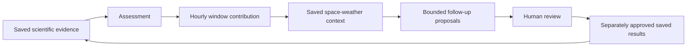

# Scientific Reasoning Enhancement

Implementation and offline investigation report, 2026-11-21. Researcher scientific
review remains required. No commit, push, PR, paid LLM call or new Framework D
execution is part of this implementation task.

## Workflow and scientific boundary

The existing model-controlled evidence loop now supports an opt-in sequence:



`run_agent(..., reasoning_enabled=True)` and the Agent CLI's
`--scientific-reasoning` enable a submission containing up to three
`follow_up_experiments`. Host-bound reasoning evidence also enables this schema.
Without either opt-in, the accepted assessment schema and evidence modes remain
unchanged. The model chooses retrievals within the existing eight-call budget.

Each proposal contains a scientific question, supporting citations, reason,
experiment, proposed windows, evaluation criteria, scientific limitations,
`human_approval_required=true` and `execution_eligible=false`. Exact numerical
assertions still use checked `observed_facts`; prose remains qualified and free of
unchecked numbers. Nested-window proposals must cite inspected hourly diagnostics
and use the inspected pair of windows. Other supported proposal types are
space-weather controls and independent-case validation. No proposal authorizes
calculation, selects a shorter window or dispatches a scientific executor.

## Window diagnostics

`src/spatial_verification/spatial_anomaly.py` exposes
`compute_hourly_spatial_anomalies`, the existing percentile detector before
aggregation. Framework D calls the same helper and retains its original count
aggregation, strict inequalities, same-time-of-day rolling reference and
full-target-hour percentage denominator. No thresholds, references or grid
conventions changed. Legacy input orientation remains caller-supplied; Modern
diagnostics require ascending physical latitude and longitude.

`src/workflow/window_sensitivity.py` accepts actual hourly observations and any
strictly nested pair of explicit UTC windows, including extensions on both sides.
It reports exact additional hours, positive/negative grid-hour counts, unique
anomalous UTC hours, full-hour ratios, spatial changes, tied peaks, nearest
requested cells and hourly contributions. A rate comparison describes whether
additional exposure has lower anomaly incidence than the baseline; it is neither
a significance test nor a universal window-selection threshold.

Validity is explicit: finite targets, finite rolling-reference counts,
non-NaN evaluated decisions and finite target/threshold decisions are separate.
Partial references retain the established `nanpercentile` convention. No new
minimum-reference rule is imposed. Missing/unevaluated decisions use `-1` in the
saved snapshot, ordinary decisions `0`, anomalous decisions `1`. A zero count
does not establish valid normal observations. Operational limits are 744 hours
per diagnostic, 24 hours per inspection and three proposals per assessment.

The saved report is paired with `hourly_snapshot.npz`. Read-only Agent validation
reconstructs summaries from those saved observations and checks both complete
spatial count/ratio maps against the accepted experiments. It never recomputes
thresholds or infers individual hours from count differences. The generic
diagnostic API is case-independent; the supplied original-input discovery wrapper
and existing Agent evidence bundle layout remain Afghanistan-specific.

Researcher-invoked generation from approved original inputs:

```powershell
python -B -m examples.investigate_scientific_reasoning window --evidence-root <EVIDENCE_ROOT> --modern-data-dir <ORIGINAL_MODERN_NPZ_DIR> --output-dir <FRESH_WINDOW_DIR>
```

This command explicitly derives hourly detector diagnostics. It verifies original
file hashes before and after computation and rejects any disagreement with saved
A/B counts or ratios. It calls no Framework D/Stage 2 runner, generates no maps
and preserves accepted artifacts. Output must be beneath the evidence root, in a
fresh directory outside the accepted bundles and original data directory.
`binding_candidates.json` records candidate pins for review; generating a pin is
not scientific approval or authenticated source custody.

## Space-weather integration

The inspected sibling repository `space-weather-data-tools` provides
`omni_downloader.py`: `OMNIWebDownloader._parse_response`, `OMNIRecord`,
`VARIABLES`, `save_csv`, and the separate network interface `retrieve`.
The adapter in `src/workflow/space_weather_evidence.py` loads an explicit host
module path and consumes its exported CSV or delegates saved-response parsing to
that existing parser. It never calls `retrieve`, creates a downloader/session,
duplicates raw fill conversion or reimplements the scientific Kp conversion.
CSV loading verifies already processed Kp against retained `kp_x10` and rejects
raw fill sentinels instead of treating them as observations.

Kp, Dst and F10.7 retain hourly OMNI export cadence and native cadences of three,
one and twenty-four hours respectively. Repeated export rows are not independent
measurements. Naive toolkit timestamps mean documented UTC; explicit offsets are
normalized to UTC. Duplicate normalized times, contradictory calendar fields and
nonfinite observations fail. Absent hours and empty values remain null without
interpolation. Summaries include exact extrema, UTC timestamps, missingness,
units and input/toolkit hashes. No storm-classification thresholds are added.

```powershell
python -B -m examples.investigate_scientific_reasoning space-weather --input <SAVED_TOOLKIT_CSV> --toolkit-module <SPACE_WEATHER_REPO>/omni_downloader.py --source-format csv --case-id afghanistan_2022 --start-utc 2022-05-28T00:00:00Z --end-utc 2022-06-02T23:00:00Z --output <FRESH_WEATHER_JSON>
```

Use `--source-format omni_response` for a saved original response. The toolkit's
own `requests` and `urllib3` dependencies are required when importing it; these
are optional integration dependencies, not new core/Agent dependencies. The
local repository `.venv` lacks `requests`; system Python has it and was used to
test the actual original parser offline. No space-weather CSV or saved response
was found in the sibling repository. Actual Afghanistan space-weather context
therefore remains unavailable. Supply a reviewed existing export or separately
obtain one with that repository's downloader; no observations were invented.

## Read-only tools, bindings and reassessment

Add a host JSON map through `--reasoning-bindings <BINDINGS_JSON>`:

```json
{
  "window_sensitivity": {
    "artifact": "NEW_WINDOW_DIR/window_diagnostic.json",
    "sha256": "<independently reviewed SHA-256>",
    "size_bytes": 123
  },
  "space_weather": {
    "artifact": "NEW_WEATHER_DIR/weather.json",
    "sha256": "<independently reviewed SHA-256>",
    "size_bytes": 456
  }
}
```

Omit unavailable sources. Identities are relative to the evidence root and pins
are host inputs, never model arguments. Invalid bound evidence stops the CLI
before model creation. Window evidence requires Post-Spatial mode; space weather
also works in Pre-Spatial without probing spatial paths. Source snapshots are
rechecked during retrieval and before acceptance. Tools are advertised only
after validation:

| Tool | Saved observation view |
| --- | --- |
| `get_window_contribution_summary` | Bounds, added hours, counts/ratios, validity and spatial comparison |
| `inspect_window_contribution_cell` | Any nearest physical grid cell, baseline/extended/additional contributions |
| `inspect_window_contribution_hours` | Actual hourly decisions and global counts for an additional interval |
| `get_space_weather_summary` | Provenance, cadence, missingness and exact index summaries |
| `inspect_space_weather_interval` | UTC-aligned exact values and explicit nulls |

The existing Agent CLI supports these bindings with either its offline fake
script or a separately approved live invocation. All execution and citation
safeguards remain in force. The following is a deterministic FakeModel
demonstration, not a live LLM evaluation:

```powershell
python -B -m examples.investigate_scientific_reasoning demo --evidence-root <EVIDENCE_ROOT> --bindings <REVIEWED_BINDINGS_JSON> --output-dir <FRESH_AGENT_DIR>
```

After human review and separately approved investigations, bind the new saved
results and run a fresh review. `demo --reassessment-of
<PRIOR_AGENT_DIR>/scientific_assessment.json` records the prior assessment hash;
prior prose is not injected as scientific evidence and accepted reports are not
edited. Ordinary Agent runs can ask a reassessment question using new bindings.

## Observed Afghanistan result

The local demonstration used all 21 original daily NPZ files required by the
saved extended experiment. Their recorded hashes matched before and after
diagnostics. Both full grids' counts and ratios matched the accepted saved A/B
arrays exactly, preserving the existing 120-hour 10%/85% validation and canonical
peak coordinates. Historical B+C and Legacy Stage 2 were not rerun or changed.

| Quantity | Baseline | Extended | Additional |
| --- | ---: | ---: | ---: |
| UTC target hours | 120 | 144 | 24 |
| Positive grid-hour occurrences | 3,672 | 3,878 | 206 |
| Negative grid-hour occurrences | 238,392 | 253,766 | 15,374 |
| Finite target grid-hours | 617,984 | 741,570 | 123,586 |
| Grid-hours with incomplete rolling references | 15,332 | 18,873 | 3,541 |

The added hours are June 2, 2022, 00:00 through 23:00 UTC. They represent 16.67%
of extended exposure but 5.31% of its positive and 6.06% of its negative
grid-hour occurrences. There is at least one global negative anomaly in every
added hour; the lower occurrence contribution does not mean globally anomaly-free
hours. Positive anomalies occur in thirteen of those UTC hours. Of 124,392 added
grid-hours, 806 have nonfinite targets. No rolling reference is empty, but 3,541
are incomplete; full-window denominators remain unchanged.

At the nearest epicentral cell (32.5, 70), negative counts change from 95/120 to
96/144; the sole added negative hour is `2022-06-02T00:00:00Z`. At the global
negative peak (30, 70), counts change from 102 to 103 while the full-window ratio
changes from 85% to 71.52777777777779%. Comparing these independently motivated
windows is scientifically justified as a descriptive sensitivity investigation.
It does not justify selecting the shorter one to support an earthquake hypothesis.
Space-weather attribution, independent controls and predictive claims remain
unresolved.

Local-only artifacts are under `outputs/scientific_reasoning_20261121/`:
`window/window_diagnostic.json`, `window/hourly_snapshot.npz`,
`window/binding_candidates.json`, `agent_demo/`, `agent_demo_final/`, and the
accepted-artifact fingerprint records. Both Agent reviews submitted one proposal
with no validation flags and explicitly reported missing space-weather
observations. The final review references the first assessment by hash. All 85
accepted E2E-03, temporal, selection and spatial artifacts retained their hashes.

## Validation and researcher evaluation

Executed focused commands:

```powershell
.\.venv\Scripts\python.exe -B -m pytest tests/workflow/test_window_sensitivity.py tests/workflow/test_space_weather_evidence.py tests/agent/test_scientific_reasoning.py tests/agent/test_scientific_assessment_policy.py tests/agent/test_submission_reliability.py -q -p no:cacheprovider
python -B -m pytest tests/workflow/test_space_weather_evidence.py -q -p no:cacheprovider
```

The final focused repository-environment run passed **141**, skipped **1** in
21.30 seconds. System Python passed all **11** space-weather tests in 1.04 seconds,
including the actual sibling toolkit parser and exported-CSV round trip with
network prohibited. The skip in `.venv` is that optional integration dependency;
it was exercised successfully in system Python. All synthetic fixtures are
explicitly labeled and are not observed Afghanistan measurements.

An initial existing-regression run reported 42 failures, 278 passes and one skip
because the new optional binding attribute was incorrectly required on older
in-memory evidence providers. The production interface now tolerates its absence;
the 97 policy/submission tests passed after correction, and are included in the
141-test focused result above. No scientific reference or expected result was
changed to resolve these failures.

The final full-suite command is:

```powershell
$env:OMP_NUM_THREADS='1'
$env:OPENBLAS_NUM_THREADS='1'
$env:MKL_NUM_THREADS='1'
.\.venv\Scripts\python.exe -B -m pytest tests -q -p no:cacheprovider --junitxml=outputs/scientific_reasoning_20261121/full_suite.xml
```

Thread limits bound test-runtime resources without changing scientific
parameters. The same limits were used for the final focused run.

**Full result: 2,083 passed, 2 skipped, one expected warning in 1,007.27 seconds.**
The JUnit record `outputs/scientific_reasoning_20261121/full_suite.xml` contains
zero failures and zero errors. One skip is the existing symlink test because the
local account lacks symlink privilege (Windows error 1314). The other is the
optional toolkit parser test in `.venv`, successfully run in system Python as
described above. The warning is the existing simulated cleanup failure in
`test_summary_error_preserved_when_cleanup_fails`; it is not a scientific failure.

Actual Afghanistan commands executed from the repository root:

```powershell
.\.venv\Scripts\python.exe -B -m examples.investigate_scientific_reasoning window --evidence-root outputs --modern-data-dir ../gim-data-tools/processed --output-dir outputs/scientific_reasoning_20261121/window
.\.venv\Scripts\python.exe -B -m examples.investigate_scientific_reasoning demo --evidence-root outputs --bindings outputs/scientific_reasoning_20261121/window/binding_candidates.json --output-dir outputs/scientific_reasoning_20261121/agent_demo
.\.venv\Scripts\python.exe -B -m examples.investigate_scientific_reasoning demo --evidence-root outputs --bindings outputs/scientific_reasoning_20261121/window/binding_candidates.json --output-dir outputs/scientific_reasoning_20261121/agent_demo_final --reassessment-of outputs/scientific_reasoning_20261121/agent_demo/scientific_assessment.json
```

`git diff --check` passed using the per-command repository ownership override;
no global Git configuration was changed. All generated data/reports remain in
ignored `outputs/`. No dependencies were installed, and no accepted output was
overwritten. The final inventory contains the 15 paths below; a local
`changed_file_inventory.json` records their statuses and SHA-256 values for
review. Nothing has been committed, pushed or proposed as a PR.

Before any live evaluation, review the diagnostic, source pins, missingness and
alternative explanations; supply reviewed space-weather observations if
available; then run a fresh offline review with those bindings. For a live study,
the researcher must separately approve model, cost and evidence-sharing scope.
Evaluate exact citation accuracy, numerical distinctions, uncertainty, bounded
proposals and preservation of human authority. Any new Framework D experiment
requires an independent researcher decision and manual execution.

## Changed-file inventory

| Path | Change |
| --- | --- |
| `src/spatial_verification/spatial_anomaly.py` | Shared hourly detector observations; unchanged aggregation semantics |
| `src/workflow/window_sensitivity.py` | Generic nested-window diagnostics and bounded saved hourly format |
| `src/workflow/space_weather_evidence.py` | Offline toolkit adapter, UTC alignment and structured evidence |
| `src/agent/reasoning_evidence.py` | Pinned saved-result validation and read-only projections |
| `src/agent/follow_up_experiments.py` | Bounded proposal contract and scientific evidence checks |
| `src/agent/scientific_evidence_tools.py` | Optional reasoning tools and availability |
| `src/agent/scientific_review_agent.py` | Opt-in proposals in orchestration, validation and reports |
| `examples/investigate_scientific_reasoning.py` | Explicit diagnostic, weather and FakeModel demonstration commands |
| `examples/run_afghanistan_mvp_agent.py` | Host bindings and reasoning-mode CLI flags |
| `tests/workflow/test_window_sensitivity.py` | Synthetic hourly, denominator, missingness and spatial checks |
| `tests/workflow/test_space_weather_evidence.py` | Parsing, UTC, missingness and original-toolkit offline round trip |
| `tests/agent/test_scientific_reasoning.py` | Tool calls, invalid evidence/proposals, authority and reassessment |
| `docs/scientific_reasoning_enhancement.md` | Workflow, commands, scientific result and implementation report |
| `docs/e2e_hitl_mvp.md` | Link to the opt-in extension |
| `README.md` | Link to implementation and reproduction documentation |
