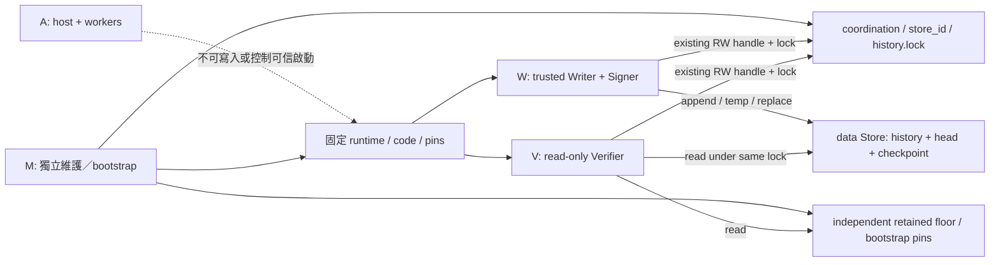

# Store publication／lock namespace 架構決策（Checkpoint 3B-2C-2C-2A）

決策：**目前 NO_GO**。現有同目錄設計無法同時給 W 建立 publication temp 的權限，
又在 OS 層禁止 W 重建已不存在的 `history.lock` 名稱。`create=False` 是應用程式
行為，不是同 token 的其他程序所受的 namespace 限制。

建議下一步驗證 **Candidate C2：將永久 lock 移至 M 管理、W/V 不可建立名稱的獨立
coordination 目錄**。保留 data 目錄內的 mkstemp/os.replace 與 V1 bytes；先不用 broker。
這是待獨立審查的內部 layout／初始化責任變更，尚未實作，也沒有解除目前的
`lock_namespace_conflict`。本次只新增本文件及普通 pytest 暫存目錄的機制觀察測試。

## 審查基準與權限對照

審查基準 commit：`959fb36f973c7579c76a468e9065ffa5d718582c`。
實際讀取 Store、LocalVerifier、inspector、preparation、相關測試與安全文件。
既有 [Store V1 說明](authorization_store_v1.md)、[LocalVerifier V1](local_authorization.md)、
[部署提案](windows_deployment_preparation.md) 保持原狀；下列是對目前程式的稽核，
不是變更它們的執行語意。

數值是 object-specific FILE_* masks：R=`0x120089`、RW=`0x12019f`、
DELETE=`0x10000`、WRITE_DAC=`0x40000`、WRITE_OWNER=`0x80000`、
FILE_ADD_FILE=`0x2`（目錄）、FILE_DELETE_CHILD=`0x40`（目錄）。
Python mode 的 CRT 開檔權限需在核定 runtime 再測；不能把 `ab` 宣稱為 NTFS
FILE_APPEND_DATA-only。下表列正常使用者模式 API 所需權限，不代表已量測到有效 ACL。
通用映射依據 [Windows file rights](https://learn.microsoft.com/en-us/windows/win32/fileio/file-security-and-access-rights)
及 [FILE_* 定義](https://learn.microsoft.com/en-us/windows/win32/fileio/file-access-rights-constants)。

| 實際程式位置／操作 | 目前行為 | 所需能力與安全意義 |
| --- | --- | --- |
| `AuthorizationStore.__init__` | Path absolute/is_dir、resolve；複製 registry，不建立 root | 目錄查詢／必要 traverse；resolve 不是 race-free trusted open |
| `initialize -> _exclusive(create=True)` | `history.lock` 的 `a+b` 可開既有檔或初次建立 | 已存在檔的 RW；若缺失還需目錄 ADD_FILE。W 可執行此 bootstrap 時，不可能同時宣稱 W 從未有該名稱的建立權 |
| `append/validate -> _exclusive(create=False)` | lock 只以 `r+b` 開既有檔；失敗為 lock_unavailable | lock 的 R/W 開檔權限，不需 data 目錄 ADD_FILE；V 因此也有 lock 檔資料寫入的 OS 能力 |
| `_acquire/_release` | seek(0)、msvcrt LK_NBLCK/LK_UNLCK 鎖 1 byte、close | 使用同一 file object 的既有 handle；不寫 lock bytes，不 rename、不重新建立；關閉釋放鎖 |
| `initialize` | iterdir，只允許 lock 已存在；history `xb` | 目錄 list、ADD_FILE；exclusive creation，不覆寫既有 history |
| `_append_history` | history `ab`、檢查 write count、flush/fsync | history 的 write/append 相關權限；該 mode 本身允許檔案缺失時建立，但目前 append 先完整 `_state`，沒有一般缺檔修復路徑 |
| `_publish` | tempfile.mkstemp(prefix='.publish-', dir=marker.parent)；fdopen wb、write、flush/fsync、close | temp parent ADD_FILE、新檔 write；prefix 僅是命名選擇，不是 ACL 的名稱白名單 |
| `_publish -> os.replace` | 將 temp 換成 head／checkpoint，無備份或清理分支 | source DELETE（或 parent 的對應刪除能力）、destination ADD_FILE、existing target DELETE 或 destination DELETE_CHILD；正常 marker 發布不必授予整個 Store DELETE_CHILD |
| `_read/_state` | rb 讀 head/checkpoint/history，bounded read、strict parse/full chain/lineages | 各檔 R；不建立檔案。沒有對所有 Store 檔案做 no-follow／physical-ID pinning |
| `append` publication | history append → head replace → checkpoint replace → 完整再驗證 | 三個持久化步驟，不是多檔 atomic commit；鎖涵蓋驗證、位置分配、signer 呼叫、所有寫入及 reread |
| exception／cleanup | `_publish` 失敗後保留 temp；with 通常關閉 handle；沒有 unlink、rollback 或自動修復 | 正常錯誤處理不需 DELETE 清理。mkstemp 後 fdopen 本身失敗的資源處置亦應納入後續內部實作審查，現在不修改 |
| `LocalAuthorizationVerifier._read_source/_locations` | stat/fstat/rb、resolve/samefile，讀 pin/config/registry/external floor，Store validate 前後再比 source hashes | 讀取與 metadata 查詢；沒有 Store 初始化／append。alias checks 不能消除 swap-and-restore race |
| inspector／preparation | inspector 查明確 PID/path；preparation 只產生資料 | inspector 不設定 ACL；preparation 無 OS I/O。宣告的 owner/rights/hash 不等於 OS enforcement |

現行 Store 沒有 chmod、SetSecurityInfo、WRITE_DAC/WRITE_OWNER 操作，沒有 mkdir 或
os.remove/unlink；新檔 owner／default DACL 由 Windows token 與 parent inheritance 決定。
需要後續 M 部署的 owner/DACL 變更不能算成 W 正常 publication 的隱含能力。

核對本機 CPython 3.10.6 對應的 [CPython 原始碼](https://github.com/python/cpython/blob/v3.10.6/Modules/posixmodule.c#L4342)：
os.replace 使用 MoveFileExW + MOVEFILE_REPLACE_EXISTING，沒有 COPY_ALLOWED 或
WRITE_THROUGH；不是 ReplaceFileW。跨 volume 時不能默默以 copy/delete 取代同卷 rename。
這是原始碼核對，並非對目前 executable 的來源認證。

## 可測試的不變條件與證據界線

| Invariant | A：可信 Python 的目前行為 | B：同 W token 的其他程序／必要 OS 條件 | C／D：本次合成證據與待驗收事項 |
| --- | --- | --- | --- |
| L1 永久 lock identity | 程式不 replace/unlink lock；目前沒有 independently pinned file-ID baseline | M 管 namespace；W/V/A 不可 DELETE/WRITE_DAC/WRITE_OWNER，也不可藉祖先改名／替換 | 本次只觀察空檔 byte-range lock 不改 bytes/file ID；真實身分與長期 identity 未驗證 |
| L2 missing-name protection | append/validate existing-only，initialize 例外 | 實際 lock parent 不得給 W/V/A ADD_FILE/ADD_SUBDIRECTORY、DELETE_CHILD、改 ACL/owner；上層不可被代換 | 既有同目錄設計與 W temp ADD_FILE 衝突。普通 fixture 的 r+b 失敗後 xb 成功僅區分 API 與 token 能力，不是隔離證據 |
| L3 互斥 | 所有 cooperating initialize/read/append 使用相同非阻塞 exclusive lock | 必須共用同一實體檔與 region；任何舊程式或新 lock inode 都不得形成第二把鎖 | 本次同程序兩個 handle 的競爭通過；跨程序／角色與 maintenance replacement 尚待真實驗收 |
| L4 W 合法發布 | 先 expected-head/lineage，再分配 position、sign/verify，最後發布 | data temp ADD_FILE、marker-specific DELETE、history RW；不授整個 parent DELETE_CHILD | 本次只測普通 bytes 的 same-/cross-directory replace；沒有生成簽章或驗證 V1 鏈 |
| L5 V 唯讀 | 只讀授權資料，例外開 lock r+b，不寫 lock bytes | V 的 history/markers/anchors 無 write/DELETE；lock RW 是真實能力例外，不是 OS 完全唯讀 | inspector 僅查詢，未做 V effective-access denial 測試 |
| L6 continuity／revocation | 全 history strict canonical/chain/signature/lineage；later revoked 不回退舊 approved | 不能只選 head 的某個批准；獨立 retained floor 限制可接受的 rollback | 既有測試原始碼已審查，本次含 key fixtures 的 Store suite 未執行，不能把機制測試當成新 V1 科學／密碼驗證 |
| L7 committed-state consistency | history EOF、head、checkpoint 必須同 store_id/sequence/digest | cooperative locks 不防惡意 W 的直接資料寫入；W 本來就在 trusted writer TCB | 部分發布的 mixed generations 已以普通 bytes 觀察；validator 拒絕此類狀態來自程式審查，不是本次端到端測試 |
| L8 interrupted publication | 不接受舊 committed prefix、不 reset/repair；marker write 分別 fsync | 單次 rename、三檔一致性、power-loss durability 是不同要求 | 三檔全寫完但 ACK 遺失可能已合法 commit；不可一概宣告 invalid，也不可重新簽一次。先唯讀確認 exact state，無自動 retry |
| L9 owner/DACL | tempfile 不提供 explicit security descriptor；replacement 不額外修 ACL | 新檔 W-owner、OWNER RIGHTS、group/privilege、繼承與結果 DACL 必須驗證；不能把 target 舊 ACL 視為自動保留 | 本次未改 ACL、未聲稱已驗證 inheritance；既有 candidate policies 仍只是提案 |
| L10 namespace/aliases | resolve/samefile 及 inspector prechecks 是診斷 | root/ancestors/coordination 都由 M 保護；拒 reparse、硬連結 alias、未知 volume/file identity；不能只看字串 | 本次僅查選定來源 metadata。hard-link 另名不產生獨立 DACL，alias 可導致資料污染／DoS，必須另測 |
| L11 external floor/bootstrap | config/registry/checkpoint raw pins、full chain floor 檢查 | M 獨立產生、保留較新 floor，固定 boot paths/pins/code/deps，禁止 A 控制 launcher 或 M/W/V session | matching pins 非 publisher authentication；舊 floor 不保證 floor 之後無 rollback；可信 clock、global freshness 均未建立 |

任何 lock 都不能強迫惡意且已有 write handle 的 W 遵守應用 protocol，也不能消除
W/V 鎖住不放的 DoS。目標是 namespace 最小權限與 cooperating-process correctness，
不是宣稱受信任 W 已失陷時仍可保證授權歷史完整或可用。

## Candidate A：分開 temporary 與 publication 位置

將 temp 移到 staging 只移除 data 目錄的 temp **建立步驟**，沒有移除最終發布的
目的 namespace 權限。對一般 rename／replace，[MS-FSA FileRenameInformation](https://learn.microsoft.com/en-us/openspecs/windows_protocols/ms-fsa/87f86c9b-6c2a-4803-84b7-131a74a434fa)
要求 destination 新增檔案 link 時具備 FILE_ADD_FILE，且覆蓋 target 還需 DELETE
或 parent DELETE_CHILD。已存在的 marker 有 DELETE 並不能取代 destination ADD_FILE。
因此若 destination 仍含 lock，同一 W token 仍有 missing lock-name recreation 能力。
以 deny prefix、只允許 `.publish-*` 或只授 target DELETE 的 ACL 宣告都不能解決。

同 volume 才能延續目前的 rename 型 publication；兩個資料夾同為 C: 字串不足以驗證
volume 身分與 reparse 狀態。跨卷 copy/delete 不是相同單檔 namespace 邊界。
[MoveFileExW](https://learn.microsoft.com/en-us/windows/win32/api/winbase/nf-winbase-movefileexw)
對跨卷另有 COPY_ALLOWED／security-descriptor 行為，不能偷偷啟用。
對同卷 move 亦不得假設改用 destination 的預期 DACL；staging 的 owner/ACL 必須先
正確，再觀察實際結果。[檔案 security descriptor 規則](https://learn.microsoft.com/en-us/windows/win32/fileio/file-security-and-access-rights)
指出 default descriptor 是新建時的行為，非一般 rename 的重新指派。

改用 [ReplaceFileW](https://learn.microsoft.com/en-us/windows/win32/api/winbase/nf-winbase-replacefilew)
也不能在未證明 namespace 限制下宣稱成功：它是不同 API，涉及同卷限制、DELETE、
可能的 WRITE_DAC／ACL merge 與多種失敗後狀態。不得擴大 W WRITE_DAC 來通過測試。
本次不實驗此替代 API。Candidate A **單獨不採用**；它最多是未來 broker 的 staging。

## Candidate B：trusted publication broker

可讓 W 不直接寫 Store，而由新增 Publisher/Broker 身分 P 負責 constrained publication。
這保護的是 **W 與 publisher 的邊界**；如果 P 仍在含 lock 的目錄有 ADD_FILE，則只是
把 recreation 能力移給 P。若要連 publisher 也沒有該 namespace 能力，仍須 C2 的
M-owned coordination。P 是新增 TCB，不能稱成沒有特權的代理。

必須先獨立審查下列 protocol，現在沒有 broker、IPC listener 或 executable prototype：

- P 是獨立 standard identity，不是 M/administrator；Store data 可建 temp、append、
  replace 固定 markers，但不可更新 registry/config/external floor/launcher；lock 只開既有。
  W 無 Store ADD_FILE/DELETE/寫入；V 仍讀完整 Store 並共用同一 permanent lock。
- 有界、strict、獨立 versioned request：`message_type=append_request`、protocol_version、
  request_id（僅 correlation）、現有 proposal/ExecutionIntent/DecisionRecord 與 exact
  expected HeadV1。禁止任意 root、檔案名稱、shell、plugin、key bytes、callback、flags。
  所有目標只由 protected bootstrap 決定：history.jsonl、head.json、checkpoint.json。
- P 必須從 OS IPC 取得 caller 的實際 W 身分並做授權，不能信 request 的 reviewer/role/SID。
  僅 local endpoint、explicit IPC DACL、拒 remote client／A，防 endpoint squatting；
  W 也須認證 server P，不能只認 pipe 名稱。預設 pipe DACL 不足以當批准。
  [Microsoft named-pipe security](https://learn.microsoft.com/en-us/windows/win32/ipc/named-pipe-security-and-access-rights)
  是後續設計基礎，PID 查詢或 impersonation 的安全層級與 token 使用須再審查。
- P 取得共同 lock 後 full-validate、比 expected_head、檢查 lineage/重複 ID，分配既有
  store position 與 authorization_id。signer **留在 W**；P 經固定可信簽章通道傳送精確
  intent/decision/allocated position，接收並驗證既有 attestation V1，再 append/publish。
  原始 signature bytes 不變；V1 已簽 authorization_id 和 position，不能自行加 unsigned
  nonce 就宣稱防 replay。等待 signer 必須有界，逾時在持久化前失敗並釋放 lock。
- 所有 P instances 都用同一個 OS lock，不能只用 Python mutex。併發 expected-head
  CAS 防兩次分配同一位置；完整歷史的 decision/authorization ID uniqueness 拒 replay。
  request_id 的 in-memory cache 不能在 restart 後當作 exactly-once 證據。
- P crash/restart：只開既有 lock，先完整 validate；partial publication quarantine，
  不 reset、不掃 temp 自動重播、不取舊批准。ACK 遺失須以已驗證鏈的 exact IDs/digests
  回報已 commit／stale/conflict，而不是自動分配新位置再簽。若要 durable request-id
  去重日誌，它是額外契約與復原負擔，不能假稱現有 V1 已提供。

這可支援未來 remote／multi-client writer，但目前增加身分、IPC 驗證、雙向 protocol、
timeouts、restart/replay 處置與可攻擊面；針對單機 lock namespace 問題不是最小變更。

## Candidate C：變更內部 publication 或 layout

**C1：pre-create 所有檔案，marker 改 in-place write。** 理論上可撤銷 W 的目錄
ADD_FILE 與 DELETE，lock 缺失時無法建立。但 marker truncate/partial write 可留下 torn
JSON，失去目前單檔 replacement 的邊界；既有三檔 fail-closed 不等於證明兩種 crash
行為等價。需要另行接受可用性／復原語意，不能為省一個目錄就採用。雙 slot、pointer
file、journal 也各有新的發布邊界／協調契約；本次不引入。

**C2：分離 lock namespace，維持 data 內的 publication。** W 的 ADD_FILE 留在 data
目錄，lock 放在另一個 M-owned 子樹。這直接將「可建新名稱」的權限作用域分開；
不需要為 marker 引入 WRITE_DAC 或更換其現有 bytes／算法。初始化永久 lock 是 M 的
bootstrap 責任，不能再算成 W 的正常建立能力。W 可初始化 data，但只開預建的 lock。

| 選項 | W 能否重建實際 missing lock 名稱 | V1 bytes／單檔邊界 | TCB 與決策 |
| --- | --- | --- | --- |
| 現況 | 同一 parent ADD_FILE 下可能可以；API 的 create=False 不足 | 不變 | NO_GO |
| A staging + W final replace | 目的仍共用 parent，未消除建立權 | 需同卷；DACL/錯誤處理要驗證 | 不單獨採用 |
| B broker，lock 同目錄 | W 可被移除直接能力，但 P 仍可能重建 | bytes 可保留 | 增加 P/IPC/簽章往返 TCB；若 P 也受相同 invariant，仍未解決 |
| B + M-owned lock namespace | 在正確 OS enforcement 下 W/P 都應無法重建 | bytes 可保留 | 可行候選，成本大於目前所需，未驗收 |
| C1 in-place | 撤銷建立權後應無法重建 | 改變 marker crash 邊界，未證明等價 | 不採用 |
| **C2 獨立 coordination** | 正確 OS enforcement 下應拒絕；尚未驗收 | **維持 V1 bytes 與現有 marker publication** | **最小後續驗證候選，現在仍 NO_GO** |

## 建議邊界與尚未批准的內部變更

下圖僅是未來 C2 提案，沒有建立任何路徑：



沿用固定 disposable RunId root R，候選 layout：

```text
R\authority\store\history.jsonl
R\authority\store\head.json
R\authority\store\checkpoint.json
R\authority\store\.publish-...                 W 可建立（確切測試資產須核定）
R\authority\coordination\<store_id>\history.lock M 預建，W/V 只開 existing
R\anchors\minimum-checkpoint.json               不在 mutable data 子樹
```

`store_id` 取自 protected V1 config，lock locator 在 trusted code 由固定 convention
`store.root.parent / coordination / store_id / history.lock` 推導，不新增 query path 或
從 data 內找另一個 lock。R、store_id、coordination locator 與 physical identity 均須由
M 獨立核定並綁定 bootstrap；不能因 convention 可算出就當成來源認證。

| Resource | W／V 所需 | 必須移除的能力 |
| --- | --- | --- |
| authority、coordination、store_id lock parent | 必要 traverse/read metadata；M-owned protected DACL | A/W/V 的 ADD_FILE/ADD_SUBDIRECTORY、DELETE/DELETE_CHILD、WRITE_DAC/OWNER；祖先替換、旁路 privilege 亦不可用 |
| 永久 lock（M-owned） | W/V 目前 CRT r+b 所需 RW，互斥 1 byte | A/W/V DELETE/WRITE_DAC/OWNER；V lock bytes 寫入能力仍是明確例外 |
| Store data directory | W list/traverse/ADD_FILE；V read/traverse | W/V 的 directory DELETE/DELETE_CHILD、WRITE_DAC/OWNER；root 由 M 擁有 |
| history／markers／temps | 保留現有候選矩陣，W history RW、marker/temp RW+DELETE；V R | 不因分離 lock 就放寬 OWNER RIGHTS、繼承或 anchors 權限 |
| registry/config/retained floor/code/runtime | M 維護，W/V 必要讀／執行 | A 與 W 不得更新 bootstrap pins 或對應 code/deps；M session 不由 A 控制 |

沒有義務把 lock 與 data 放不同 volume；先限定同一 local NTFS volume、無 reparse，
縮小實驗範圍。lock 本身不做 rename，因此其位置不需要成為 marker 的跨卷 staging。

**未來需要另批的 internal changes（本次完全不改）：**

1. Store 統一 lock locator；initialize/append/validate 都 existing-only。M 的初始
   CREATE_NEW 只允許新的核定 run，沒有「缺失就修復」路徑。
2. initialize 改為驗證 data root empty、external lock pre-provisioned；不得在 data
   root 建 lock，不得接受舊同目錄 lock 作 fallback。舊程式和新程式不得同時運行。
3. under-handle 的 identity／volume/reparse/alias 檢查與 M 保護的 baseline，避免
   precheck 後被換名。不能拿開發 inspector 的 point-in-time PASS 當 trusted open。
   lock 應以不跟隨末端 reparse 的既有 handle 取得後再核對及鎖定；目前的普通
   `Path.open('r+b')` 本身不提供這項保證。唯讀 parent 保護名稱，不等於禁止所有
   對 lock 物件內容／metadata 的操作；RW 例外與實際 privileges 下的 reparse 修改
   能力仍是 blocker，不可未測就宣稱一定被 OS 拒絕。相關 native 行為見
   [Reparse point operations](https://learn.microsoft.com/en-us/windows/win32/fileio/reparse-point-operations)。
4. LocalVerifier `_locations` 目前只排除 `root/history.lock` alias，須納入實際 external
   lock、ancestors/baseline；對外 `verify(intent_digest)` 不需要增加任意 path 參數。
5. 更新 lock lifecycle、初始化／缺 lock／並行／失敗測試；新舊部署協調規則需停止
   全部 reader/writer，不能允許一群鎖 old file、一群鎖 new file。M 不得在舊 handle
   尚存時 recreate；若需 recovery，獨立批准新部署／baseline，不自動接受新 file ID。
6. 現有 Inspector/preparation 的 V1 layout 把 history_lock 固定在 Store 內，不能表達 C2。
   後續須另行核定 versioned layout/acceptance contract，保留 V1 拒絕新 layout 的行為；
   不可悄悄改 RESOURCE_LAYOUT 或把目前 blocker 標成已解除。

**不需要改的 authorization wire/storage schema：** ExecutionIntent、DecisionRecord、
attestation Domain Prefix/canonical/signing bytes、StoreEntry/Head/Checkpoint V1、
digest bindings、lineage/revocation／expected-head 語意。VerifierConfigurationV1 的
store.root/store_id 可保持原欄位；新增 lock convention／physical-ID custody 屬新的
部署與內部 code 約定，仍須審查及 release pins 更新，並非「零部署變更」。

## 本次安全驗證與未驗證內容

2026-10-30 的唯讀檢查僅選取當前 sandbox Python PID 與 authorization_store.py metadata：
兩項 query PASS，RID 1003、integrity SID S-1-16-8192（Medium）、elevated=false、
has_restrictions=true、來源 filesystem=NTFS。沒有取得／推論 W/V/M 或 native host
primary token；這些結果不建立完整 sandbox 邊界，不驗證開發 repo 是 trusted runtime。

新增 `tests/workflow/test_store_publication_observations.py` 的 **8 個測試通過**：

- 普通 fixture 內 missing-file r+b 不建立檔案；同 token 的明確 xb 可以建立名稱。
- 同目錄與同卷不同目錄各一次 os.replace：target 接收 source file identity/bytes；
  只觀察此 fixture，不推論其他 ACL、跨卷、power loss 或權限拒絕行為。
- replace 前注入例外，old marker 不變且 flushed temporary 留存；不是原生 ACL denial。
- 在 append／first marker／second marker 後注入例外，觀察 mixed generations 與全部
  完成但 ACK 遺失的 bytes；沒有 V1 Store 或替代 validator。
- 空檔 offset 0／1-byte 的同程序兩 handle 非阻塞互斥、release 後另一 handle 可取得；
  bytes 空、file identity 不變。不是跨 SID 或不合作程序測試。

每個可寫路徑只來自 pytest 新建 tmp_path，只有合成 bytes。沒有設定 ACL/owner、
帳號或 privilege；pytest 一般 fixture retention/cleanup 不接觸外部部署。非 Windows
或缺少必要 file identity／CRT 時明確 skip。沒有匯入 Store、signer、科學模組或 key fixtures。

執行命令：

```powershell
.\.venv\Scripts\python.exe -B -m pytest tests/workflow/test_store_publication_observations.py tests/workflow/test_windows_deployment_preparation.py tests/workflow/test_windows_isolation_acceptance.py -q -ra --tb=short -p no:cacheprovider
.\.venv\Scripts\python.exe -B -m pip check
```

實際結果：**136 passed，0.55 秒，無 skip**；pip check 無 broken requirements。
完整 Store／LocalVerifier suite 的簽章 fixtures 會生成私鑰，本次未執行。也沒有執行
Framework A/B/C/D、Stage 2、安裝 runtime、真實 Store 初始化／簽章或 destructive
access attempts。這些機制觀察不能認證 Windows SID isolation、broker 或 C2 已可部署。

## 唯一建議的下一個原生驗證實驗 E1（尚未批准／未執行）

目標只驗證 **C2 的 lock namespace**，不建完整 broker、signer 或真實 Store。
先提交獨立 sacrificial deployment plan，由研究者批准 exact R/RunId、volume/resolved
paths/file IDs、完整 A/W/V/M SIDs、逐項 before/after owner/SDDL、合成檔案 inventory、
各角色實際操作與預期 Win32 errors、M 失敗處置。不能拿現有 V1 manifest 表達 C2，
不能在開發 repo／.venv／production／未知既有目錄做這個實驗。

批准後才由 M 預建兩個 sibling namespaces 與合成空 lock；由真實 W/V primary token
分別執行以下最小權限檢查（現在沒有提供可執行 deployment/denial-test script）：

1. W 在 data 成功 mkstemp、write/flush、replace 預建 synthetic marker；觀察 source/target
   owner/SDDL/identity。不給 data DELETE_CHILD；權限不足則停止，不加 Modify/FullControl。
2. W/V 既有 external lock r+b／lock/unlock 成功，bytes 不變，reader/writer 互斥；
   另一 token 持鎖時非阻塞失敗。A 無該 capability。
3. W/V/A 對 coordination、lock parent 和 lock 的 create/delete/rename/replace、
   WRITE_DAC/WRITE_OWNER 及 ancestor replacement 皆按核定政策拒絕。
   另核定對現有 lock 設定／移除 reparse data 的測試；若 RW 例外允許改動，就不能
   記錄為 OS denial。必須確認 no-follow/identity checks 能 fail closed，並由研究者
   裁定這是否符合要求；若要求所有 namespace 重導向操作本身皆被拒而無法做到，
   C2 仍 NO_GO，不能以「偵測得到」冒充「OS 不允許」。
4. 先停止全部程序並確認沒有舊 handle，再由 M 做**唯一獨立批准的合成 missing-lock
   故障注入**。W/V existing-only open 失敗，不能經 create、copy、rename、hard-link 或
   child-directory substitution 把新檔安插到實際 lock 名稱。必須觀察 OS 拒絕，不能只看
   Python API 不呼叫 create。硬連結若能建立 alias，共享同一 descriptor 的影響亦須記錄；
   它不應取得 coordination parent 建立權，但可造成 DoS，不能忽略。
5. 不自動修復或 recreate；保留 evidence，M 另行批准 retirement。任何無法歸因的結果
   都是 UNKNOWN/NO_GO，不宣告隔離成功。

E1 若通過，只證明指定 SIDs/paths/rights 的 namespace 行為。之後仍需另批 C2 internal
implementation 與允許 key fixtures 的 V1 concurrency/revocation/partial-publication
回歸；完整可信授權還需要受保護 runtime、launcher、獨立 pins/floor、M 與 A 分離、
人類身分／時間來源及全體 Agent 能力盤點。E1 失敗則保持 NO_GO，依拒絕的具體權限
重新審查 C2，不能直接部署 broker 或放寬 ACL。

hard-link 的 descriptor／alias 分析依據 [CreateHardLinkW](https://learn.microsoft.com/en-us/windows/win32/api/winbase/nf-winbase-createhardlinkw)：
多個名稱指向同一檔案且共享 security descriptor。對於 W 的 r+b 所授權限，不能在
未測前假稱所有 hard-link 建立皆會被拒；實際命名空間拒絕與 alias/DoS 檢查需分開記錄。

```text
Windows Local Isolation: NOT VERIFIED
Trusted Human Authorization: NOT VERIFIED
Execution Eligibility: FALSE
Deployment Decision: NO_GO
```
